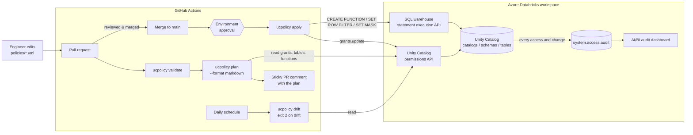

# uc-policy-as-code

**Unity Catalog access governance as code.** Grants, row filters and column masks
are declared in version-controlled YAML, reviewed in a pull request, applied by
CI through the Databricks SDK, and checked daily for drift.

```console
$ ucpolicy plan policies/
Plan: 1 privilege(s) to grant, 2 to revoke, 3 row filter/mask statement(s).
  + catalog finance                      finance_engineers                MODIFY
  - table finance.payments.transactions  contractors_tmp                  SELECT
  ...
```

## The problem

In a Unity Catalog metastore, access is usually granted by hand: a `GRANT` in a
notebook, a click in Catalog Explorer, a ticket that says "temporarily give the
contractors SELECT". After a few months nobody can say *why* a group can read a
table, grants for people who left are still there, and the PII masking that
was set up for one table was never added to the next. Audit questions ("who could
read card numbers in March, and who approved it?") take days to answer.

This project treats access the way infrastructure-as-code treats infrastructure:

| Need | How it is handled |
|---|---|
| One reviewed source of truth for who can access what | YAML policy files per catalog, validated with pydantic and a JSON Schema |
| No change without review | `plan` runs on every PR and posts the diff as a comment; `apply` runs only after merge |
| Catch changes made outside the process | Scheduled `drift` job: excess grants, missing grants, orphaned principals, removed masks; non-zero exit |
| PII protection that cannot be forgotten | Row filters and column masks declared next to the grants and applied as Unity Catalog SQL |
| Evidence for auditors | SQL over `system.access.audit` for an AI/BI dashboard: reads, grant changes, changes made outside the pipeline |

## Architecture



Inside the CLI the flow is: **load and validate YAML → read live state through a
`Backend` → diff into a `Plan` → render (text / Markdown / JSON) or apply.**
`DatabricksBackend` uses `WorkspaceClient().grants`, `.tables`, `.functions` and
`.statement_execution`; `SnapshotBackend` reads the same state from a JSON file,
which is how the examples and tests run without a workspace.

```
src/uc_policy/
├── models.py    # pydantic schema for policy files, privilege validation, loading
├── backend.py   # DatabricksBackend (SDK) and SnapshotBackend (JSON file)
├── sqlgen.py    # CREATE FUNCTION / SET ROW FILTER / SET MASK statements
├── planner.py   # diff policy vs. live state; apply the plan
├── drift.py     # drift report: excess, missing, orphaned, mask/filter drift
├── render.py    # text, Markdown (PR comment) and JSON output
└── cli.py       # `ucpolicy` entry point
```

## Policy files

One file per catalog. The minimal form:

```yaml
catalog: finance
grants:
  - principal: finance_analysts
    privileges: [USE_CATALOG, SELECT]
  - principal: finance_engineers
    privileges: [USE_CATALOG, SELECT, MODIFY]
```

Schemas, tables, row filters and masks nest under it (abridged from
[`examples/policies/finance.yml`](examples/policies/finance.yml)):

```yaml
unmanaged_principals: [platform_admins]   # never revoked, never reported

schemas:
  - name: payments
    grants:
      - principal: finance_analysts
        privileges: [USE_SCHEMA]
    tables:
      - name: transactions
        grants:
          - principal: finance_auditors
            privileges: [SELECT]
        row_filter:
          function: governance.region_filter
          columns: [region]
        column_masks:
          - column: card_number
            function: governance.mask_card_number

functions:
  - kind: column_mask
    name: governance.mask_card_number
    parameter: { name: card_number, type: STRING }
    exempt_groups: [finance_pii_readers]
    masked_expression: "concat('XXXX-XXXX-XXXX-', right(card_number, 4))"

  - kind: row_filter
    name: governance.region_filter
    parameters: [{ name: region, type: STRING }]
    exempt_groups: [finance_engineers, finance_auditors]
    group_rules:
      - group: finance_analysts_in
        condition: "region = 'IN'"
```

The functions above become:

```sql
CREATE OR REPLACE FUNCTION `finance`.`governance`.`mask_card_number`(card_number STRING)
RETURNS STRING
RETURN CASE WHEN is_account_group_member('finance_pii_readers') THEN card_number
            ELSE concat('XXXX-XXXX-XXXX-', right(card_number, 4)) END;

CREATE OR REPLACE FUNCTION `finance`.`governance`.`region_filter`(region STRING)
RETURNS BOOLEAN
RETURN is_account_group_member('finance_engineers') OR is_account_group_member('finance_auditors')
    OR (is_account_group_member('finance_analysts_in') AND (region = 'IN'));

ALTER TABLE `finance`.`payments`.`transactions`
  SET ROW FILTER `finance`.`governance`.`region_filter` ON (`region`);
ALTER TABLE `finance`.`payments`.`transactions`
  ALTER COLUMN `card_number` SET MASK `finance`.`governance`.`mask_card_number`;
```

**Semantics.** For every catalog, schema and table listed in a policy file, the
file is authoritative: privileges not declared there are revoked by `apply` and
reported by `drift` (except for `unmanaged_principals`). Securables that are not
listed are left alone, so you can adopt the tool one catalog or schema at a time.
Masks and row filters on listed tables are authoritative in the same way.

**Validation** (`ucpolicy validate`, also the first CI step) rejects, before
anything touches a workspace: unknown keys (typos), privileges that do not apply
to the securable type (e.g. `USE_CATALOG` on a table), a principal listed twice,
masks or filters that reference undeclared functions, a mask used as a row filter,
row filters whose column count does not match the function, unsafe identifiers,
and the same catalog declared in two files. `ucpolicy schema` prints the JSON
Schema ([`schema/policy.schema.json`](schema/policy.schema.json)); the example files
reference it so editors with the YAML language server autocomplete and validate
as you type.

## Quickstart

Requires Python 3.11+.

```bash
git clone https://github.com/bishakh-dutta/uc-policy-as-code.git
cd uc-policy-as-code
python -m venv .venv && source .venv/bin/activate   # Windows: .venv\Scripts\activate
pip install -e ".[dev]"
```

Try it without a workspace, against the bundled snapshot of "live" state
([`examples/live_state.json`](examples/live_state.json)), which contains some
deliberate drift:

```bash
ucpolicy validate examples/policies
ucpolicy plan  examples/policies --state-file examples/live_state.json
ucpolicy drift examples/policies --state-file examples/live_state.json --resolve-principals
```

Against a real workspace, authenticate the way any Databricks SDK tool does
(environment variables or a `~/.databrickscfg` profile):

```bash
export DATABRICKS_HOST=https://adb-<workspace-id>.<n>.azuredatabricks.net
export DATABRICKS_CLIENT_ID=...        # service principal (OAuth M2M), or
export DATABRICKS_CLIENT_SECRET=...
# export DATABRICKS_TOKEN=...          # a personal access token
export DATABRICKS_WAREHOUSE_ID=...     # needed by apply for row filter / mask DDL

ucpolicy plan  policies/
ucpolicy apply policies/               # asks for confirmation; --auto-approve in CI
ucpolicy drift policies/ --format json
```

### Commands

| Command | What it does | Exit code |
|---|---|---|
| `ucpolicy validate [PATH]` | Schema and consistency checks, no workspace access | 1 on invalid |
| `ucpolicy plan [PATH]` | Diff against live state; changes nothing. `--format text\|markdown\|json`, `--out FILE` | 2 with `--detailed-exitcode` and pending changes |
| `ucpolicy apply [PATH]` | Applies the plan. Grants are batched into one `grants.update` call per securable, then function / filter / mask DDL runs in dependency order. `--no-revoke` only adds | 1 on error |
| `ucpolicy drift [PATH]` | Drift report. `--format text\|json`, `--json-out FILE`, `--resolve-principals` | **2 on drift** |
| `ucpolicy schema` | Prints the JSON Schema for policy files | 0 |

`PATH` is a file or a directory of `*.yml` files (default `policies/`). Every
command that reads state accepts `--state-file` (offline JSON snapshot) or
`--profile` (a `~/.databrickscfg` profile).

## Example output

`ucpolicy drift examples/policies --state-file examples/live_state.json --resolve-principals`:

```text
DRIFT DETECTED

Excess grants (in the workspace, not in policy):
  - table finance.payments.transactions  contractors_tmp                  SELECT
  - schema finance.crm                   former_finance_lead@example.com  USE_SCHEMA

Missing grants (in policy, not in the workspace):
  + catalog finance  finance_engineers  MODIFY

Orphaned principals (hold grants but are declared in no policy):
  ! contractors_tmp                  on finance.payments.transactions  [NOT FOUND in workspace]
  ! former_finance_lead@example.com  on finance.crm                    [exists]

Row filter / column mask drift:
  ~ create_function  hr.core.mask_salary          (function does not exist)
  ~ set_mask         finance.crm.customers.phone  (currently unprotected)
  ~ set_mask         hr.core.employees.salary     (currently unprotected)

Summary: 2 excess, 1 missing, 2 orphaned principal(s), 3 row filter/mask difference(s).
```

- **Excess grant**: a privilege in the workspace that the policy does not declare
  (for example a manual `GRANT SELECT ... TO contractors_tmp`).
- **Missing grant**: declared but absent (someone revoked it outside the pipeline).
- **Orphaned principal**: holds grants on a managed securable but appears in no
  policy file. With `--resolve-principals` each one is also looked up through the
  workspace SCIM API (groups, users, service principals), so grants left behind
  for deleted groups are flagged `NOT FOUND`. Principals that the policy grants to
  but that do not exist are reported too.
- **Row filter / mask drift**: a mask or filter removed, changed or added by hand,
  or a function whose body no longer matches the policy.

The same report as JSON (`--format json`) has `excess_grants`, `missing_grants`,
`orphaned_principals`, `unknown_declared_principals`, `security_drift`,
`warnings`, `has_drift` and a `summary` of counts, for alerting or for loading
into a Delta table.

The PR comment rendered by `plan --format markdown`:

````markdown
### Unity Catalog policy plan

```diff
Plan: 1 privilege(s) to grant, 2 to revoke, 3 row filter/mask statement(s).
+ catalog finance                      finance_engineers                MODIFY
- table finance.payments.transactions  contractors_tmp                  SELECT
- schema finance.crm                   former_finance_lead@example.com  USE_SCHEMA
~ create_function  hr.core.mask_salary          (function does not exist)
~ set_mask         finance.crm.customers.phone  (currently unprotected)
~ set_mask         hr.core.employees.salary     (currently unprotected)
```

<details><summary>Equivalent SQL</summary> ... GRANT / REVOKE / ALTER TABLE statements ... </details>
````

## CI/CD setup

Four workflows in [`.github/workflows`](.github/workflows):

| Workflow | Trigger | Does |
|---|---|---|
| `ci.yml` | every PR and push | ruff, ruff format, mypy (strict), pytest on Python 3.11 to 3.13, plan/drift against the offline snapshot. No secrets. |
| `policy-plan.yml` | PR touching policy files | `validate`, then `plan --format markdown`, posted as a single PR comment that is updated on each push |
| `policy-apply.yml` | merge to `main` touching policy files, or manual | `apply --auto-approve` in the `databricks-prod` environment, then `drift` to confirm convergence. Runs are serialised with a concurrency group |
| `drift.yml` | daily 03:30 UTC, or manual | `drift --resolve-principals`; the report goes to the job summary and an artifact; the job fails on drift |

Set-up steps:

1. **Create a service principal** for CI in the Databricks account, add it to the
   workspace, and generate an OAuth secret for it. Give it `MANAGE` (or
   ownership) on the catalogs it governs, `USE CATALOG` / `USE SCHEMA` and
   `CREATE FUNCTION` on the schema that holds the mask functions, and
   `CAN USE` on one SQL warehouse.
2. **Add repository secrets** (*Settings → Secrets and variables → Actions*):
   `DATABRICKS_HOST`, `DATABRICKS_CLIENT_ID`, `DATABRICKS_CLIENT_SECRET`
   (or `DATABRICKS_TOKEN` instead of the two OAuth values), and
   `DATABRICKS_WAREHOUSE_ID`. Nothing secret is stored in the repository.
3. **Create the `databricks-prod` environment** (*Settings → Environments*) and add
   required reviewers so that apply waits for an approval after merge. Put the
   secrets on the environment instead of the repository to limit which jobs can
   read them.
4. **Protect `main`**: require PR review and the `ci` and `policy-plan` checks.
5. Change `POLICY_PATH` in the three policy workflows from `examples/policies`
   to your own folder.

For a first rollout on an existing catalog, run `drift` first, copy what you want
to keep into the policy, and use `apply --no-revoke` until the plan shows no
unexpected revokes.

## Audit dashboard

[`sql/audit/`](sql/audit) has six queries over `system.access.audit`: table access
by principal, all grant changes, grant changes not made by the CI service
principal (the source of most drift), access to the masked/filtered tables, denied
requests, and a daily activity summary. [`docs/audit-dashboard.md`](docs/audit-dashboard.md)
walks through building a Databricks AI/BI dashboard from them, including the
grants needed to read the `system` catalog.

## Development

```bash
pip install -e ".[dev]"
pytest          # unit tests; the Databricks SDK is mocked, no workspace needed
ruff check . && ruff format --check .
mypy            # strict
```

Tests cover policy validation, SQL generation, planning (including ordering and
convergence: apply then plan again yields no changes), drift reporting, the CLI,
and `DatabricksBackend` against a mocked `WorkspaceClient` (pagination,
`NotFound`, batched `PermissionsChange` requests, statement polling and failure).

## Limitations

- **Tested with mocks, not yet against a live workspace in CI.** The SDK calls are
  covered by unit tests with a mocked `WorkspaceClient`; the repository does not
  run an integration test against a real metastore.
- **Scope is catalogs, schemas and tables.** Volumes, functions, models, external
  locations and storage credentials are not managed yet. Views can be governed as
  tables for grants.
- **Ownership is not managed.** Owners have implicit privileges that do not appear
  as grants; use `ALTER ... OWNER TO` separately.
- **Direct grants only.** Drift compares privileges granted directly on each
  listed securable. Inherited privileges (e.g. `SELECT` on a catalog applies to
  all its tables) are not expanded; the planner does not warn when a catalog-level
  grant makes a table-level one redundant.
- **Mask and filter expressions are raw SQL.** `masked_expression` and
  `condition` are inserted as written. They come from reviewed PRs, but treat
  write access to the policy repo as a privileged role.
- **Function comparison is textual.** A function is replaced when its body differs
  from the generated SQL after whitespace normalisation. Changes to parameter
  types alone are not detected; `CREATE OR REPLACE` on apply will still update it
  if the body changes too.
- **Principal resolution uses workspace-level SCIM.** Account groups that are not
  assigned to the workspace show as `NOT FOUND`.
- **Audit queries depend on `request_params` keys**, which vary by action. They
  follow the documented `system.access.audit` schema; check them against a few raw
  rows in your workspace (see the dashboard guide).
- **ABAC policies** (Unity Catalog attribute-based access control with governed
  tags) are not used; this tool attaches filters and masks per table.

## License

[MIT](LICENSE)
